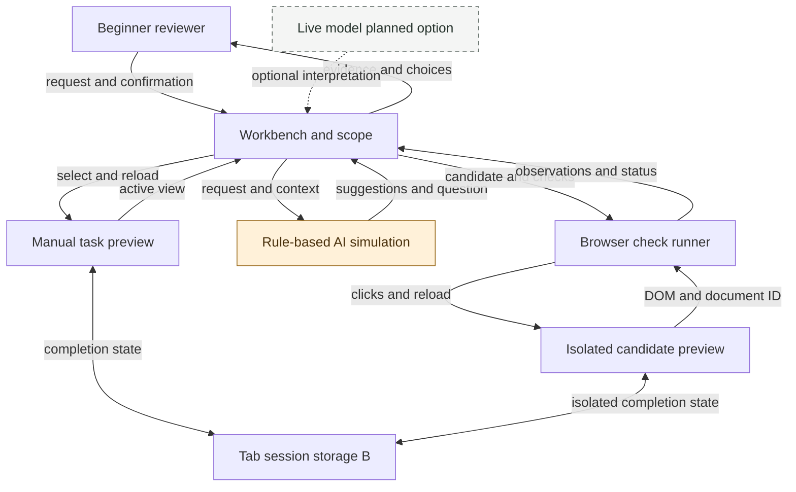

# System architecture

## Boundaries

- **Implemented.** The workbench, editable scope, task previews, check runner and decisions run in the browser. A local HTTP server supplies the files. The previews and workbench share an origin so the runner can inspect the preview's task controls.
- **Simulated.** The request interpreter uses bounded rules. It considers the request, the active task view and whether the reviewer used manual reload. The candidate repairs are fixed examples.
- **Observed evidence.** The list check measures membership and completion in the rendered task list. The reload check compares the state of the target task across two actual browser documents. Check frames use separate storage keys and remove their test state on completion.
- **Review scope.** Session storage supports reload of the current tab. Visual presentation can be assessed using the manual preview. Acceptance covers the selected requirements and current candidate.
- **Candidate comparison.** The runner executes each confirmed check for both candidates. The workbench keeps the observations under their respective candidates and clears the comparison when the reviewer changes scope.
- **Planned option.** A model could propose check IDs and clarifying questions. The browser runner would still derive evidence from the candidate application.
