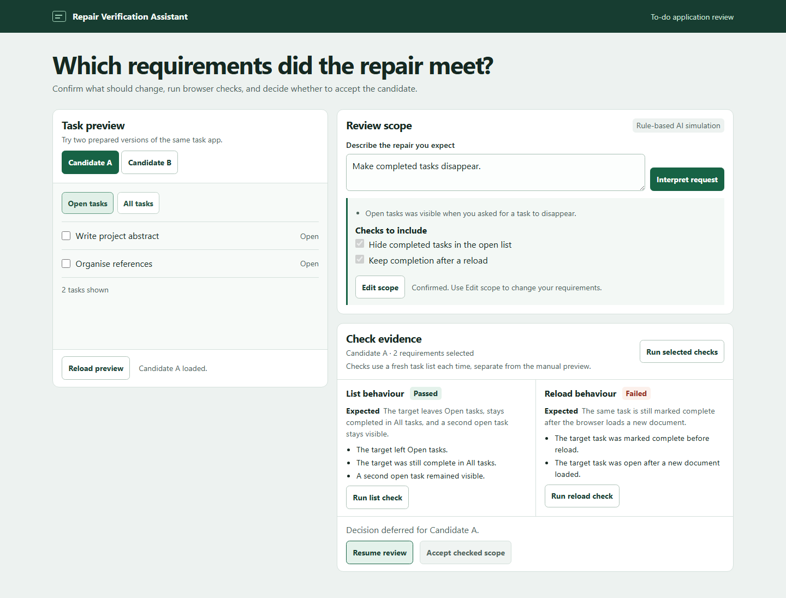
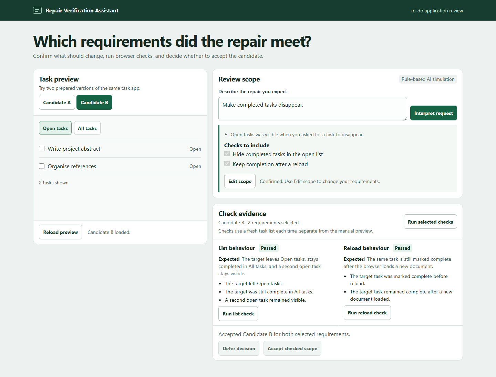
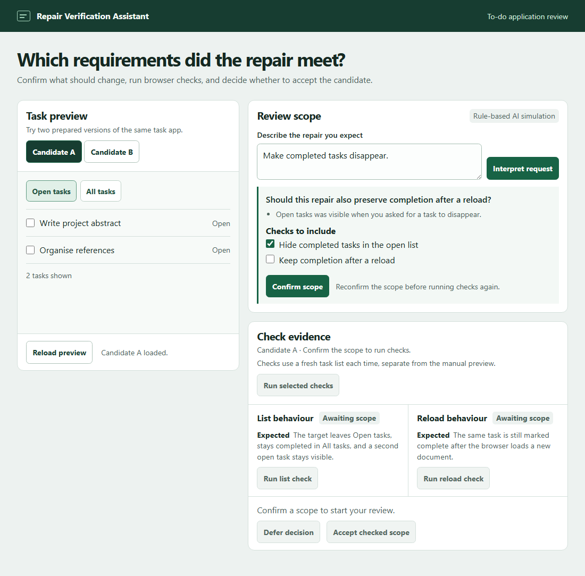
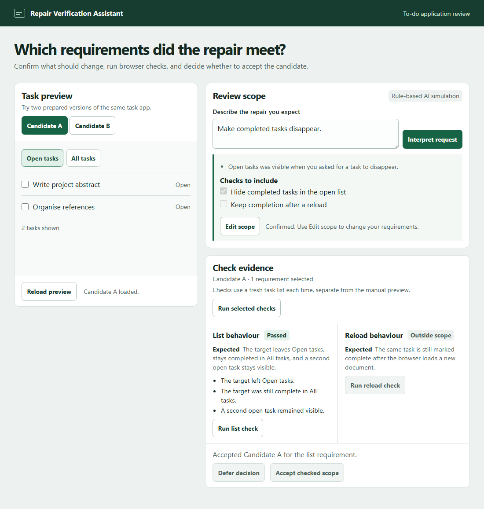

# Interaction walkthroughs

These captures come from the Playwright browser suite. Use the workbench and the same sample request to replay the interactions.

## A partial repair is deferred

1. On Candidate A, select **Interpret request**. Add the reload check and confirm the scope.
2. Run the list check. It passes. Run the reload check. The task is open in the new preview document and the check fails.
3. Select **Defer decision**. The workbench shows the decision and proof of each outcome.

## The revised candidate is accepted

1. Switch to Candidate B. The scope stays selected and both checks await new evidence.
2. Run the selected checks. Both pass. Select **Accept checked scope**.
3. The workbench names Candidate B and both selected requirements in its confirmation.

## The reviewer corrects the scope

1. Start with both checks in scope. Run the list check, then select **Edit scope**.
2. Clear the reload requirement. Previous evidence is cleared and the workbench asks for reconfirmation.
3. Confirm and run the selected checks. Reload is outside scope and the user can accept the list requirement on its own.

